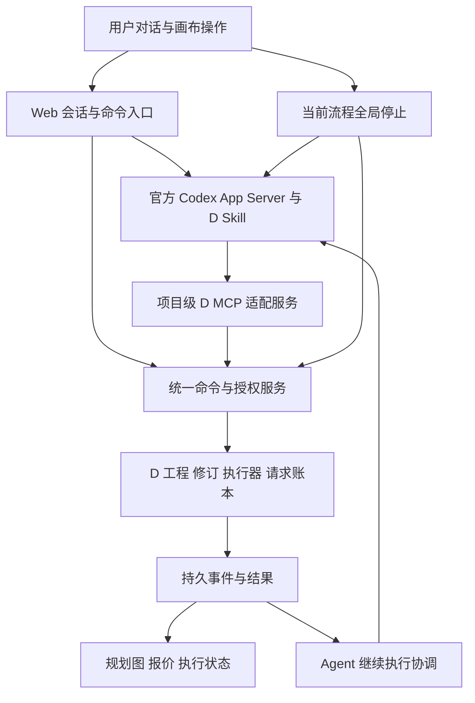

# Codex 插件体验对齐迭代方案

日期：2026-10-20。状态：代码与本地自动化实施完成；真实模型质量、两轮用户验收及剪映实机验收待完成。实际证据与适配边界见 [实施记录](PARITY-IMPLEMENTATION.md)，本方案的完成门槛不因自动化主链路通过而降低。

本轮目标是保留本地 Codex 使用 D 插件的完整制作体验，并增加规划、报价和执行状态的可视化。Codex 应当能够通过对话完成规划、执行、全局停止、检查结果、局部修改、继续制作、审片和交付。网页按钮与聊天操作使用同一套业务命令。

“全局停止”指当前项目中当前制作流程的整体停止，覆盖关联的待执行及运行中构建，不影响其他项目。停止后可以只修改指定节点，再复用其他有效结果继续制作。本轮不以分支级停止、提高生成并发或分段编码为前置条件。

## 体验基线

基线必须同时包含 Codex 运行时版本、推理模型及参数、D 的实际代码版本、Skill 与引用文件、工具契约、素材访问方式、预算审批和后台任务回传方式。仅使用相同的 Codex 运行时不足以证明体验一致。

当前安装的 workbench-d 2.0.0-beta.1 工具清单有 41 项；项目迁入源码有 43 项，额外包含 `d_bind_brand_lock` 和 `d_review_brand_build`。二者已有差异，实施前应固定代码和契约哈希，以 41 项既有工具的语义对齐为底线，对两个新增工具单独记录验收，不退回删除品牌能力。

当前 SaaS Agent 只公开 `get_project`、`save_plan`、`ask_user`、`request_production`。迭代应取消这一固定的业务能力上限，使 Agent 能使用 D 的完整业务工具和原 Skill 流程。保留平台自己的文件上传、用户提问及执行授权工具。

| 体验类别 | 对齐范围 | 验收依据 |
|---|---|---|
| 会话与指令 | 流式对话、项目上下文、恢复、运行中补充指令、全局停止 | 不要求用户等待整个制作完成才能修改方向 |
| 工程制作 | 能力查询、创建/编辑、校验、规划构建、提交、检查、取消、继续 | 原 D 工具语义与结果可追溯 |
| 创作能力 | 原插件实际可用的素材、图层、媒体、语音、组件与品牌能力 | 不被精简 Shot 模型静默裁掉；依赖缺失如实显示 |
| 审片反馈 | 预览、审片副本、按帧反馈、处理/重开反馈 | 可以通过对话完成，不强制改用按钮 |
| 工作流复用 | 归档、搜索、替换输入预检、实例化 | 素材与参数绑定一致，预算不继承 |
| 剪映 | 选择导出、创建/检查/编辑/导入/安装支持范围内的草稿 | 沿用插件拒绝不支持操作的边界 |
| 可视化增量 | 执行前完整规划图、增量报价、版本差异、真实运行状态 | 图、价、执行对应同一冻结版本 |

推理模型先保留现有配置。对比测试应尽可能使用相同模型、模型参数、Skill、素材和工具集；模型不同时分别报告工具接入结果和规划质量，不承诺逐字回复或随机生成结果完全相同。全局停止不依赖模型推理速度。

本轮验收环境是当前本机 Web 服务。原插件依赖的本机剪映安装和文件访问通过受控接口保留；未来上云需要上传/下载或本地辅助程序承接，不能让云服务器路径冒充用户电脑路径。个人 Codex 的其他无关插件、账户、登录态和通用终端不作为本次 D 制作体验迁移的隐含对象。

## 目标架构

优先使用项目级 MCP 服务接入 D，保留工具名称、参数含义、说明和 Skill。MCP 适配只负责项目绑定、文件 ID 解析、授权校验和事件归档，调用迁入的同一 D 核心，不再另写一套制作逻辑。平台扩展工具与 D 工具可以共存。具体 MCP 配置和审批协议按固定版本的本地 schema 验证。

如特定模型网关需要工具协议转换，工具定义应从同一注册表生成，执行仍进入同一个服务；不再维护另一份只有四个名称的白名单。不能仅把 `plugins=false` 改成 `true` 就视作迁移完成，也不能绕开原有费用与项目校验。

后台执行完成后，持久事件驱动 Agent 继续检查、解释结果、审片或交付。协调器按会话顺序处理消息，对重复完成事件去重；用户已停止时只更新结果，不自行继续新工作。进度事件只更新界面，完成、失败或需要用户决定的事件才按需唤醒 Agent，避免频繁轮询模型。

## 现有模块处理方式

| 模块 | 迭代方式 |
|---|---|
| `server/local/bridge.py` | 从策划助手桥接扩展为完整项目 Agent；加载 D Skill、连接 MCP、处理补充指令和继续执行 |
| `server/local/gateway.py` | 保留供应商适配与规划费用记录；工具转换改为注册表驱动，覆盖 MCP 工具命名与结果往返 |
| `server/local/main.py` | 聊天、画布按钮、全局停止统一进入命令服务；增加需要用户决定和后台完成事件的映射 |
| `server/local/production.py` | 拆分出报价、授权、素材复用和交付包装；D 原生文档成为执行依据，逐步退役限制能力的固定编译入口 |
| `server/local/models.py` | 人物/镜头模型保留为创作说明与展示元数据，关联 D 节点；不再限制 D 可表达的任务、图层与参数 |
| `server/local/db.py` | 保留项目归属、会话、用户授权、总预算与事件；执行事实以 D 构建和请求账本为准 |
| `server/local/worker.py` | 收敛为恢复、事件同步和结果核对；不与 D Worker 重复解释或调度同一任务 |
| `commercial/` | 保留完整 D 业务能力和回归测试；仅在一致性、复用或恢复确有缺口时调整核心 |
| `web/WorkflowCanvas.tsx`、`workflowGraph.ts` | 保留现有交互与性能优化，支持执行前的规划图和 D 的真实依赖；不能永远限制为固定镜头行 |
| `server/local/workflow.py` | 统一规划、复用、执行与历史版本的公开投影；严格区分规划节点与实际请求 |

新增边界按职责组织为工具注册与适配、命令与授权、Agent 继续执行、规划与报价投影。优先在现有进程内完成，不因拆文件引入新的数据库、消息队列或微服务。

## 核心行为

### 全局停止与运行中修改

用户说“先停下来，我要修改”，或点击全局停止，均作用于当前制作流程。按钮直接进入后端停止命令；自然语言在活跃轮次中通过经过验证的插话或“中断后优先处理新指令”机制传递，不再以“正在执行，请等待”作为唯一处理方式。

后端先持久化停止状态及执行代次，再中断 Agent 的继续推进、取消待执行工作，并对运行中构建发出取消请求。新提交在提交边界检查停止状态与代次；停止前已经越过提交边界的请求必须记录为在途，不能漏记或重复提交。

结果查询、下载和对账在停止后仍可继续。界面分别表达“已阻止新增工作”“本地执行正在停止/已停止”“远端请求待核对”，不提前宣称所有外部工作已经终止。远端晚到结果归入原构建，可供新修订显式复用，不能覆盖新版本。

停止命令幂等，关联当前流程的所有 build。修改规划不会自动恢复执行；新范围与报价确认后才恢复。这里不要求独立停止某个并行分支。

### 规划 可视化 报价与授权

Codex 使用 D 原生工程表达制作方案，人物和分镜说明作为稳定 ID 关联的创作信息。后端保存精确修订，并生成执行前的规划图、复用清单、待执行节点、影响范围和报价。

每次确认绑定工程修订、文档哈希、输入素材及配置身份、执行范围、报价和费用上限。用户可以在报价卡确认，也可以在上下文明确且仅有一个待确认报价时通过对话确认；授权必须由用户输入或 UI 事件形成服务端回执，不能仅凭模型调用授权工具就增加预算。

修改规划、替换素材或改变执行范围后，旧报价不能授权新输入。已授权范围内的正常步骤不反复询问。聊天和画布按钮读取及操作同一份状态。

规划阶段的节点标记“待确认/计划复用/计划重做”；确认后才绑定实际 build、请求和结果。当前图只在构建存在后出现真实生成节点的行为，不能满足本轮执行前预览，应予扩展。

增量报价列出新增生成、已复用、需重新合成等项目，并区分本轮预估费用、已经发生的规划费用、旧请求待对账预留。旧请求未确认取消或退款时不将其费用自动抵扣。外部账单未知不能显示成零成本。

### 全局停止后的局部返工

保留已完成的节点结果和输入身份，读取停止后的实际状态。Codex 修改用户指定部分，后端比对新的 D 工程，检查依赖和输入变化，得出需要重做及可以复用的集合。共享人物、参考图等变化可能影响多个镜头，影响范围必须在确认前显示。

成功结果的复用至少考虑输入内容哈希、提示词、模型与影响生成结果的参数、参考图角色、实现版本和输出兼容性。显式“重新生成一次”应创建新的尝试身份，不通过改写提示词绕过缓存。时长和裁切变化区分“已有素材足够”与“必须补生成”。

对受影响的下游进行校验和重做；其余分支复用精确产物。新结果按节点到时间线图层的映射进入新版本。时长变化需明确保持原时间槽还是顺延，并检查字幕、配音、转场与音轨约束。

首版沿用 D 整片合成。用户看到的是对应片段被替换，其他内容保持不变；不承诺只编码受影响的几秒。分段渲染是后续性能优化，不阻塞功能验收。

### 原生插件能力的完整接入

为全部 41 项既有工具及 2 项迁入扩展建立映射和对照测试，覆盖项目、构建、预算、审片、画布回执、工作流、剪映生命周期和旧工作区导入。

不得直接暴露默认数据根的 `api.dispatch` 给任意项目。项目级适配应解析当前项目的执行仓库，并校验 project/build/review/workflow/draft 等身份的归属。跨项目复用走明确的归档或素材导入操作。

文件路径转换为受控工作区内的真实资源，并保留原工具能力；不能为了隐藏路径而拿掉导入、预览和草稿安装等功能。原插件需要的参考文件、Skill 引用及工具结果进入 Agent 可访问的项目上下文。只提供视频文件名不等于具有视频理解能力；实际理解方法按本地工作流基线接入并验收。

## 迭代顺序

下表为一名熟悉本项目的工程师的初步工作量估算，每个工程日约 8 小时。范围包括实现和非付费回归，不包含用户验收等待、供应商故障或复杂环境准备。完整范围估计 9～14 个工程日；阶段结果可提前交付，不把“停止能用”当作整轮完成。

| 阶段 | 工作内容 | 可验收结果 | 估算 |
|---|---|---|---|
| P0 固定基线 | 41+2 项工具对照、Skill 资源、模型与版本、原生场景清单；建立回退点 | 每项能力有保留/适配方式和测试用例，差异明确 | 1 日 |
| P1 恢复 Agent 工具与闭环 | 项目级 MCP、Skill、动态注册表、费用授权接入、完成事件继续执行 | 纯对话可创建、规划、制作、检查并交付；无需手工点击制作按钮接力 | 2～3 日 |
| P2 全局停止与插话 | 持久停止状态、提交边界、活跃轮次补充指令、旧请求核对 | 用户中途叫停，修改后能继续；停止后不再产生未经恢复授权的新请求 | 1～2 日 |
| P3 统一规划图与增量返工 | 完整 D 文档投影、冻结报价、差异/复用、强制重生成、版本绑定 | 两种返工场景均先展示新图和增量报价，确认后只新增必要生成 | 2～3 日 |
| P4 全能力对照与切换 | 审片/工作流/剪映全工具验证、旧项目兼容、两轮用户验收修复、退出重复路径 | 所有基线能力有通过证据或明确的既有环境限制，不以主链路通过替代完整对齐 | 3～5 日 |

P1 先消除“Codex 只做规划、后面靠按钮”的结构差异；P2 修复全局停止；P3 完成可视化与返工要求。P4 是“与本地插件体验一致”的完成门槛，不能无限期搁置。

## 两个端到端验收场景

### 场景一 运行中全局停止并修改一个分支

1. 用同一组素材规划 A、B、C 三个独立镜头及最终合成，展示图与报价。
2. 确认后开始制作，在执行中说“全部先停，B 换一种表现，其他尽量保留”。
3. 系统确认停止范围和在途请求状态；已经完成的素材仍可查看。
4. Codex 修改 B，画布展示新修订、A/C 的复用或未完成状态，以及受影响的合成节点。
5. 新报价只包含需要新增的操作；旧在途费用单独展示。
6. 确认后恢复，最终输出使用精确绑定的新旧素材；旧版本与费用记录保留。

若 C 在停止前尚未执行，它不是可复用结果；新报价必须包含仍需执行的 C。不能把“没改”误当成“已经完成且免费”。

### 场景二 完成后重规划并局部返工

1. 完成一版视频，通过对话指出 B、C 的规划问题。
2. Codex 编辑相应部分，保留 A 与其他不受影响输入，展示变更理由、范围和新图。
3. 生成增量报价并等待用户确认。
4. 新结果进入正确片段，未修改内容在语义上保持一致；MP4 与剪映工程对应同一新版输入。
5. 再发出“B 的提示词不变，再生成一次”，验证强制重生成不会命中旧缓存。
6. 再只改字幕，验证新增视频生成请求为零，同时合成和交付正确更新。

除这两个场景，还必须覆盖停止与提交竞态、结果晚到、重复确认、Agent/Worker 重启、SSE 重连、报价过期、无关项目不受影响、原生工具错误提示与旧版本下载。供应商交互先用可控模拟验证状态，再在明确预算范围内完成真实验收。

性能记录从本次实施起分开测量规划、报价、取消确认、供应商执行、合成与导出，不用外部生成时间掩盖本地编排延迟。已有短片历史样本可作比较，不能作为新系统 SLA。

## 数据迁移与回退

新项目优先采用“一个 Web 项目关联一个稳定 D 工程及其修订”的映射，替代当前每次制作重新创建 D 工程并使用 revision 0 的方式。既有项目保留旧 plan/task/build/delivery 身份和只读历史；首次编辑时基于明确选择的旧修订建立新映射，不重写旧交付或请求回执。

切换前备份控制库、执行库和运行版本，先用独立数据目录验收。每个项目固定执行路径，避免旧适配器与新 MCP 路径同时提交同一任务。回退恢复相应运行版本与数据映射，不复制或重发未知远程请求。

D 的实现指纹包含 commercial 目录全部 Python/JavaScript 源码。旧在途构建应保留原运行版本执行和核对；无法保留时先停止并完成状态核对，再以明确的新构建继续，不能伪造旧指纹。模块裁剪放在对齐通过之后。

## 冗余处理与完成标准

优先修复剪映 ZIP 误打包中间帧，以及重复全量刷新；不删除未来需要恢复的 D 工具入口、审片或工作流能力。两层数据库和预算账本先明确各自事实来源，只有经验证确实重复的逻辑才合并。

本轮完成要求：41 项既有工具和 2 项扩展均有能力映射；所有可在基线环境执行的能力通过对应验证；两种返工场景在 Web 对话中完成；图、价、授权和执行始终绑定同一版本；历史结果可追溯；已知依赖或剪映实机限制逐项保留。仅恢复全局停止或完成一个示例视频，都不足以宣布体验对齐。

## 源码依据

- [原始 Codex 接入合同](v0.1-local-spec.md)：原定受控 MCP、制作工具、授权范围内自动推进与版本复用要求。
- [当前 Agent 桥](../server/local/bridge.py)：四个动态工具、简化指令、私有会话与中断。
- [规划网关](../server/local/gateway.py)：四工具白名单与供应商协议转换。
- [本地制作适配](../server/local/production.py)：固定编译、缓存、报价与 D 工程映射。
- [D 工具目录](../server/app/workbench_d/commercial/api.py)及[扩展目录](../server/app/workbench_d/commercial/stage4_api.py)：43 项迁入工具。
- [D MCP 入口](../server/app/workbench_d/commercial/mcp.py)：共享工具与分派逻辑。
- [画布同步现状](WORKFLOW-LAYOUT.md)：当前图为执行事实投影，尚未完整对齐 D 画布协议。
- 本机基线契约：`C:/Users/Administrator/.codex/plugins/cache/personal/workbench-d/2.0.0-beta.1/skills/workbench-d/references/tools.json`，41 项工具。
