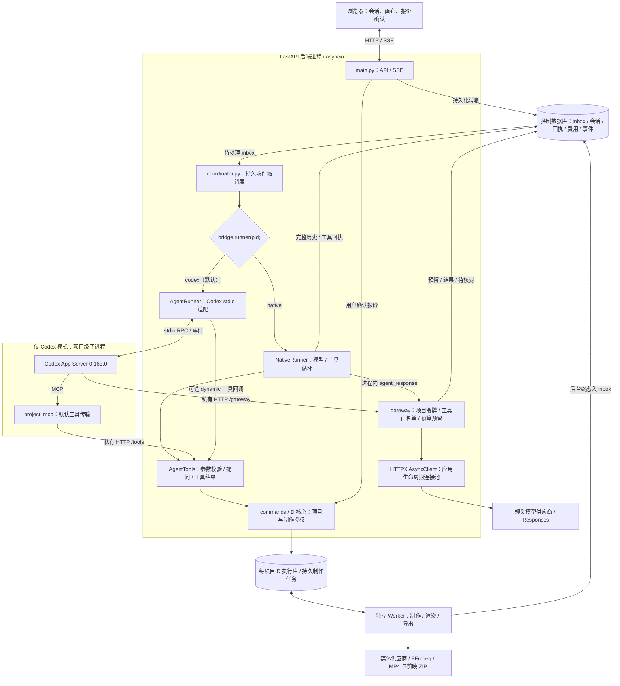
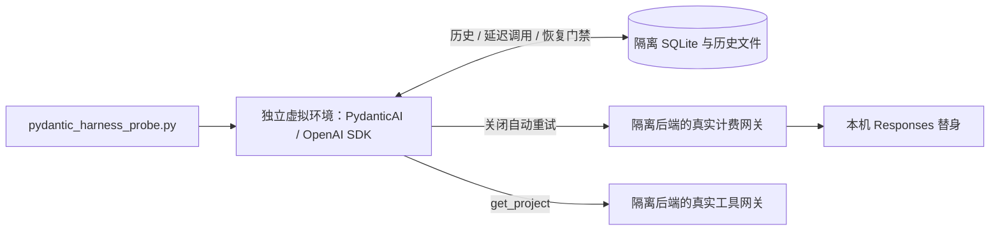

# 自研 harness 与 Codex 切换

## 当前架构（2026-10-22）

当前分支同时支持 native 与 Codex，默认仍为 Codex。native 的核心仍是自研 `NativeRunner`；本轮落地的是两种底座共用的规划网关连接池。PydanticAI 仅在隔离脚本中验证，未进入产品运行路径。



图中箭头表示主要调用和持久化方向，模型流与工具结果沿原调用返回。两种 Agent 路径按配置二选一；Codex 的 MCP 和 dynamic 也是两种工具接入方式。Worker 独立于 Agent 循环，模型提出制作请求仍须通过后端用户授权。

连接池由 `main.lifespan` 在启动 Worker 和协调器前创建，在关闭所有 Agent 后释放。每个模型请求单独设置凭据、不转发上游 Cookie；结束或取消只关闭自己的响应，不关闭共享池。没有 lifespan 的独立调用使用请求级客户端；连接中断或未知结果不自动重试。

| 层 | native | Codex |
|---|---|---|
| 模型 / 工具循环 | 后端进程内 `native_harness.py` | 项目级 Codex App Server |
| 工具接入 | 直接调用 `AgentTools` | MCP 私有 HTTP 或 dynamic 回调 |
| 会话保存 | 控制库 `native_session` / `native_turn` | 应用独立 Codex 会话目录及 thread ID |
| 共享边界 | 工具、项目事实、用户授权、规划网关连接池、预算账本、Worker | 同左 |

### 隔离候选：不属于产品架构



原型验证了跨进程提问恢复、重复恢复拦截及发送前历史处理。产品仍没有自动上下文压缩或跨进程恢复待回答问题；产品依赖未增加 PydanticAI。采用依据、限制和复现命令见[改进执行记录](NATIVE-HARNESS-IMPROVEMENT-PLAN-2026-10-22.md)，原版测试见[对比报告](NATIVE-HARNESS-COMPARISON-2026-10-22.md)。

## 配置切换

在 `config.local.json` 增加以下配置，重启服务后生效。省略 `agent_runtime` 时沿用 Codex。

```json
{
  "agent_runtime": "native",
  "native_harness": {
    "max_model_requests": 32,
    "max_context_bytes": 4194304
  }
}
```

回退时改为 `"agent_runtime": "codex"` 并重启。`agent_transport`（MCP / dynamic）只对 Codex 生效；规划模型继续使用原来的 `planning` 配置，媒体模型配置仍由后台制作程序读取。

## 实现边界

| 接口 / 能力 | 行为 |
|---|---|
| `bridge.runner(pid)` | 根据配置选择底座；同一服务运行期间禁止改换实例的底座，需重启 |
| `turn(text, file_ids, selected)` | 返回轮次 ID，后台异步执行模型与工具循环；同一项目只允许一个活跃轮次 |
| `busy` | 当前轮次活跃，或协调器正在派发 |
| `stop()` | 停止模型流，取消待回答问题；已开始的同步工具完成并保存回执后才允许下一轮 |
| `answer(qid, answer)` | 将答案交回原轮次；本地资源授权仍由后端检查、写入 |
| `read_turn(thread_id)` | 只读持久化轮次，不发模型请求、不执行工具 |
| `close()` | 取消当前轮次并释放网关令牌 |

`native_harness.py` 不启动 Codex、MCP 或其他 Agent 子进程；多个项目在后端同一个 asyncio 事件循环中运行。工具内部的 FFmpeg、导出程序和制作 Worker 仍可能启动进程，因此这不表示整个产品只有一个进程，也不表示已经实现多用户服务。

两种底座使用同一份业务指令、D Skill、工具注册表和 `AgentTools`。native 直接进入 `commands.dispatch`，工具结果不经过 Codex 的截断层；截图以 `input_image` 返回模型。请求仍经过 `gateway.agent_response`：凭据、工具白名单、规划费用预留、总预算和供应商错误处理保持在后端。模型调用授权或提交工具仍只得到报价，实际下单需要用户确认。

前端沿用 `item/agentMessage/delta`、`item/started`、`item/completed`、`turn/started`、`turn/completed` 和提问事件；bootstrap 返回实际的 `agent_runtime`，界面据此显示名称。

## 持久化与恢复

native 在控制数据库的 facts 表新增 `native_session` 和 `native_turn` 记录，无需额外数据库服务。保存完整协议历史、轮次、收件箱关联，以及执行工具前后的回执。

服务重启后，协调器只读轮次核对是否已完成。完成的回复按消息 ID 去重；中断、失败或结果不明的调用不自动重试。下一条新消息会保留旧会话并用项目快照建立新会话，避免重放工具或把缺少结果的调用重新交给模型。

切换底座、模型或工具目录时也用项目快照新建会话；旧会话留在 `prior_threads` 中。native 不启动 Codex 来核对旧的 Codex 未知轮次，这类记录保留为待核对。切换不是两种底座之间逐条迁移协议历史。

## 当前限制

- 每轮最多 32 次模型请求，工具按返回顺序执行。到上限后保存记录并提示，继续需要新消息，不自动续跑。
- 默认请求上限 4 MiB，不能高于网关的 8 MiB 限制。还会用请求 UTF-8 字节数加输出上限，对配置的模型上下文窗口做保守检查；这不是精确 tokenizer，也不是图片 token 计量。
- native 暂不自动压缩历史，超限会停止并提示，完整历史留存。`model_auto_compact_token_limit` 和 `tool_output_token_limit` 用于 Codex；native 不使用它们截断工具结果。豆包的默认上下文窗口仍由共享模型配置读取。
- 中途插话继续走持久收件箱：先停止当前轮次，再处理新消息。已开始的同步工具不会因为停止 Agent 而回滚；后台制作的全局停止仍由业务代码执行。
- 不执行任意命令，不加载个人技能或插件，也不继承 Codex 的编程提示词。
- 原型的单用户、同项目单协调器约束仍然存在；多实例租约、分布式提问和租户隔离不在本次实现内。

协议依据：[OpenAI Responses 工具调用文档](https://developers.openai.com/api/docs/guides/function-calling)。真实火山方舟多轮调用和图片兼容性、真实规划质量仍需供应商实测，本地替身不能证明这些指标。

## 非付费验证

```powershell
.venv/Scripts/python.exe -m pytest tests/test_native_harness.py tests/test_codex_config.py tests/test_security.py -q
.venv/Scripts/python.exe scripts/gateway_pool_probe.py
powershell -ExecutionPolicy Bypass -File scripts/verify.ps1

$env:VC_TEST_RUNTIME='native'
.venv/Scripts/python.exe scripts/parity_web_probe.py
$env:VC_TEST_RUNTIME='codex'
.venv/Scripts/python.exe scripts/parity_web_probe.py
Remove-Item Env:VC_TEST_RUNTIME
```

端到端脚本创建隔离的 `.local/parity-web-*` 数据目录，模型与生成供应商均为 loopback 替身。覆盖报价确认、重启不重复提交、停止、只重做 B 并复用 A/C、再次修改 B/C、提示词不变强制重做、字幕无需重新生成、图片审片、MP4 与剪映 ZIP 成对交付。结果保存在该次目录的 `summary.json`、`model-requests.json` 和数据库中；截图仍由原浏览器脚本写入本机 `docs/evidence/parity/`。

2026-10-22 本机两种底座的端到端验收均通过。native 的规划后进程采样中，Codex/MCP 子进程数为 0；该采样不包含后台制作进程的数量，也不是并发容量测试。

连接池改动后完整 Python 回归为 104 通过、2 项既有基线缺失失败；安全与 native 专项 30 通过。真实 HTTP/1.1 探针中，每组 11 次请求由 11 个 TCP 连接降至 1 个，native / Codex 的非付费端到端均通过。合成历史原型请求体减少 88.13%，不代表产品已有压缩能力或真实模型质量已验证。

完整 `verify.ps1` 仍有两项旧测试因历史资料缺失而失败：`test_catalog_contracts` 缺少 `docs/evidence/parity/installed-tools.json`，`test_baseline_hashes_and_demo_rejected` 缺少 `docs/evidence/template-baseline-20261020/` 的基线文件。没有重建或伪造旧基线；其余测试、画布图测试及前端构建已单独验证。

另一次 Codex 端到端运行在媒体资源锁 `owner.json` 的原子替换处出现 Windows `WinError 5`，独立重跑通过。本次未修改共享的媒体资源锁实现，仍需关注该文件占用问题。
