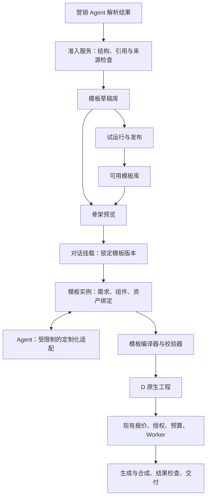

# 模板功能扩充开发方案

日期：2026-10-20。状态：待审查设计。

在现有 D 制作核心之上新增模板应用层，支持营销 Agent 提交结构化模板、模板库展开工作流骨架、将精确模板版本挂载到对话，以及按用户素材与片长生成可校验的 D 原生工程。现有报价、预算、停止、恢复、素材复用和 MP4／剪映交付继续作为执行基础。

本次交付是开发方案、准入 Schema 与示例；不修改运行中的应用，不导入真实模板，不发起模型生成。这里对齐的是已调研的模板使用体验，Higgsfield 私有实现不是设计前提。

## 一 需要审查的产品决定

| 决定 | 建议 |
|---|---|
| 模板定位 | 可参数化的创作工作流，包含骨架、提示词配方、资产槽、变化规则、能力要求和检查条件 |
| 入库与发布 | 通过准入检查即可进入作者草稿库；通过实际试运行及发布审核后进入可用库 |
| 用户入口 | 模板库 → 点击卡片展开样片与骨架 → 使用此模板 → 挂载到输入框 → 提交需求和素材 |
| 默认挂载数量 | 每次创作实例挂载一个主模板；允许多个产品／人物／场景资产槽和模板声明的组件选择 |
| 允许变化 | 在声明范围内改片长、展开重复段、选择组件、绑定不同数量的身份资产、调整文案与场景 |
| 工作流展示 | 抽象模板骨架与本次实际执行图分开；展示生成依赖，也展示最终播放顺序 |
| 制作授权 | 挂载和发送需求不等于付费制作授权；费用明确后，用户点击生成进入现有确认流程 |
| 发布档位 | 区分“辅助制作”和“自动制作”；包含人工检查的模板可以发布为辅助制作，不冒充自动完成 |
| 本期范围 | 完成准入、预览、挂载、受约束实例化和已有执行链路闭环；多阶段自动制作列为独立交付项 |

## 二 模板在架构中的位置



新增 `server/app/creative_templates/`，集中管理协议、模板版本、实例、适配计划和编译。网站 API 与 Agent 工具调用同一个服务，不为模板另建制作队列或计费系统。

现有 D 工作流归档可以成为模板的一个执行配方，但不能替代模板的展示信息、用户输入契约、可变骨架和创意检查。首版以声明式配方编译为 D 工程；引用 D 归档作为可选适配路线，不作为所有模板入库的必需条件。

当前新项目已走 D 原生工程。旧文档中扩展 `Plan/Shot` 的接入建议由本方案替代；旧项目继续保留现有兼容路径。模板元数据保存在独立对象中，以 D 工程 ID、修订、文档哈希关联，不直接给严格的 D Schema 塞入未知字段。

## 三 准入协议

### 交接对象

营销 Agent 提交 `TemplateCandidateEnvelope`，Schema 见 [template-admission-v1.schema.json](schemas/template-admission-v1.schema.json)。对应 [候选模板示例](examples/template-admission-v1.example.json)使用演示资产引用，只用于协议校验，不可作为真实模板入库。

| 部分 | 必需内容 | 准入时检查 |
|---|---|---|
| 请求身份 | 协议版本、命令 ID、生产方条目 ID、预期模板修订 | 重复命令返回原回执；同 ID 不同内容拒绝；更新校验修订 |
| 来源与分析 | 源视频注册引用与哈希、分析记录引用与哈希、带时间范围的观察 | 服务端解析引用、校验可访问范围和源媒体时长；区分观察与推断 |
| 展示信息 | 名称、用途分类、摘要、标签、预览类型 | 草稿允许无样片；源视频预览明确标为“参考原片” |
| 素材与输入槽 | 随包素材引用、用途与来源状态；产品／人物／场景等槽、数量范围 | 外部资产先登记；公共素材与用户实例素材分开 |
| 参数与组件 | 可改字段、类型、默认值、可选 Hook／Setting 等及替换规则 | 只能使用声明的变量、组件和替换目标 |
| 创意骨架 | 每段作用、顺序、重复数量、时长上下限、创意要求 | 可展开为有限实例；不得用执行图中的环表达重复 |
| 提示词配方 | 身份、创意、环境、动作、限制及变量清单 | 变量必须有来源；只作受限字符串替换，不运行表达式 |
| 执行骨架 | 节点类型、执行方、输入角色、依赖、能力 ID | 检查有向无环图；能力 ID 必须经服务器注册表解析 |
| 检查条件 | 结构规则、视觉检查、失败处理范围 | 结构覆盖与视觉合格分别记录 |

生产方身份来自连接认证，不能由请求体自报；第一版可使用操作者授权的导入命令，后续外部 Agent 接入同一服务。生产方不能通过上传 `published=true`、价格、授权记录或“验证成功”绕过平台状态。

### 资源登记与提交顺序

1. 营销 Agent 将源视频、分析结果、获准分发的公共素材登记到受控资源接口，取得资源 ID、实际哈希和访问范围。引用型资源必须在本系统中存在；不能把作者机器路径直接提交给 SaaS。
2. 提交候选模板 JSON。准入服务验证格式、资源真实性、语义引用和可展开性，返回逐字段问题。
3. 格式或引用错误时，不建立可用模板版本；保存失败导入回执，方便 Agent 修正。通过的候选进入作者草稿库，可以查看骨架。
4. 缺少已接通的生成能力或真实样片时，草稿保留明确的发布阻塞项，不声称已经可执行。
5. 作者通过真实试运行、审阅与发布服务升级状态。实际执行回执由系统关联，导入方不能自行证明试运行成功。

首版传 JSON 与注册资源引用，暂不接受 ZIP、任意脚本或自动抓取上传字段中的 URL。来源 URL 只作出处；资源获取由上游采集和资源登记流程负责。

### 生命周期与权限

```text
候选提交 → 准入通过 → draft → reviewed → runtime_validated → published
             ↓                                  ↓               ↓
         失败回执                         新内容生成新修订      retired
```

作者可查看和挂载草稿用于规划、修复与明确授权的试运行；普通使用入口只展示已发布版本。草稿挂载条标明“试作模板”，不能进入普通制作入口。

`retired` 阻止新挂载和新付费制作，历史实例、回执与交付仍可读取。正在执行的任务保留既有授权，是否停止通过现有停止接口明确处理。模板更新不会自动替换既有挂载或实例。

状态与检查报告由服务端产生。内容更改形成新不可变修订，并使该修订重新接受检查；旧发布版本可以继续服务。

### Schema 之外的语义校验

JSON Schema 负责字段、类型、范围和枚举；以下规则必须由准入服务额外实现：

- ID 唯一、所有引用可解析、图无环、变量均有定义、节点输入输出类型兼容。
- 节点声明的 `parameter_inputs` 必须匹配能力注册表的参数契约；例如片尾文案明确绑定 `params.end_copy`，不能靠能力名称猜测取哪个用户字段。节点产物引用还必须出现在对应依赖中，模型输出的媒体类型由已注册能力确定。
- 源观察的时间范围位于真实源视频内；解析声明与原始分析记录绑定。
- 时长和数量上下限自洽；默认片长至少存在一种满足全部必需段的分配。
- `same_instance` 依赖只用于同一重复段中的节点；跨段或汇合使用 `all_instances`。展开后再检查图与资源上限。
- 组件仅能替换声明的提示词段与创意要求，不允许执行任意路径修改。选择后重新计算有效要求及覆盖表，不能沿用被替换规则的通过记录。
- 容量超过服务器上限、模型不支持所需参考角色、检查方法未注册，给出明确问题。能力尚未配置可入草稿，但不能通过运行就绪检查。
- 公共包不能引用用户私有实例素材。未知来源素材可以保留在作者研究区，不自动成为公开样片或可分发资产。
- 发布要求本系统实际生成的样片、关联试运行记录、已知限制及操作者批准。建议至少三个适用产品样本；这是发布初始门槛，不是统计成功率承诺。

组件内联在不可变模板修订中，首版随模板版本一起固定；独立组件库作为后续扩展。Schema 中的能力 ID、检查方法 ID 和时长算法名称是待实现的注册契约，不表示当前 D 已提供同名工具。旧 `0.2.0-proposal` 示例不直接作为新请求提交，需显式迁移并重新检查。

服务端采用确定的 JSON 规范化规则计算内容哈希：对象键排序、UTF-8、拒绝重复键及非有限数；保留具有语义的数组顺序。模板内容哈希不包含命令 ID、状态、服务端回执或可变统计。哈希算法版本单独记录。

### 准入反馈

返回 `admission_id`、`accepted`、`template_id/revision/content_hash`（仅通过时）、结构问题和发布阻塞项。每个问题包含 `code`、JSON Pointer `path`、说明、修复建议和是否阻塞入库。

错误码至少包括：`SCHEMA_INVALID`、`ASSET_NOT_FOUND`、`ASSET_HASH_MISMATCH`、`REFERENCE_MISSING`、`GRAPH_CYCLE`、`VARIABLE_UNBOUND`、`DURATION_UNSATISFIABLE`、`REVISION_CONFLICT`、`IDEMPOTENCY_CONFLICT`、`CAPABILITY_UNAVAILABLE`、`PUBLICATION_EVIDENCE_MISSING`。

营销 Agent 可用同一校验接口预检，按问题修改后用新命令 ID 提交；只有网络重试沿用原命令 ID。不以自动重试无限修改创作内容。

## 四 工作流骨架预览

模板库区分“可用模板”和作者可见的“草稿”。卡片显示样片或占位图、名称、用途、支持片长、输入要求、发布档位和版本。

点击卡片展开右侧详情，默认展示三个区域：

1. 样片与用途说明；无本系统样片时明确显示草稿或参考原片。
2. 骨架画布：资产槽 → 生成与加工节点 → 检查节点 → 汇合与成片。可重复段显示“1～4 段”，未绑定资产显示槽名。
3. 节点详情：作用、固定与可改内容、参考输入、提示词配方、时长范围、依赖和检查要求。

提供“默认骨架”和“按当前选项展开”两种视图。调整片长、组件和资产数量时，由纯函数重新计算预览；不调用生成模型，不创建 D 工程，不预留费用。

最终播放顺序用独立的段落条展示。执行依赖图中并列的节点不代表最终画面同时播放；预览也不承诺服务端实际并发额度。

首版复用现有画布的视觉组件和必要的布局能力，但抽象图有自己的类型，不伪装成带真实产物状态的 D 工程，也不写入 D 浏览器可见回执。

## 五 对话框挂载与持久化

```text
用户点击 使用此模板
→ 输入框上方出现模板挂载卡
→ 上传素材，绑定产品／人物等槽，选择片长和组件
→ 输入“换成我的香水，背景更简洁”
→ 发送时原子保存消息、模板实例与 Agent inbox 引用
→ Agent 按精确实例进行适配
```

挂载卡显示名称、版本、片长、已绑定／缺失素材，并提供“展开骨架”“替换模板”“移除”。未发送前的挂载是可恢复的输入草稿；刷新后保留，发送失败不清空。

新任务还没有项目时，用独立 `composer_id` 保存草稿，发送时创建项目并转移挂载。附件上传先暂存到该草稿或项目；消息只有在全部必要引用就绪后才提交。初始化消息、实例、inbox 通过服务层统一提交，避免当前先创建项目再补发 initial 消息的路径丢失模板信息。放弃的暂存附件按引用检查后清理。

首次可以只发送模板和已绑定素材，不强制用户再写一句文本；服务端生成可读摘要，同时保存结构化引用。后续对话默认继承当前实例，但每条消息和 inbox 都记录准确的实例修订，不运行时读取“最新版本”来猜用户原意。

第一版一个实例只挂载一个主模板。替换模板在发送前只是更换草稿；已有制作记录时创建新实例，不覆盖旧工程。运行中的构建不会因为 UI 换了模板就被当成已停止；新消息可进入规划，是否停止旧制作按现有明确停止动作处理。

发送后的“移除模板”应当是显式脱离模板的编辑操作，创建新的实例状态并使未执行报价失效；删除输入框挂载卡不能抹去历史消息或旧交付的模板来源。

挂载卡的交接字段建议如下。这里使用占位 ID；真实内容哈希由后端读取已存在的模板，客户端值仅用于一致性核对，不作为授权依据。

```json
{
  "command_id": "message-command-id",
  "text": "换成我的香水，做成20秒，背景更简洁",
  "composer_id": "composer-id",
  "expected_composer_revision": 3,
  "template_mount": {
    "template_id": "template-id",
    "revision": 2,
    "content_hash": "<服务端返回的内容哈希>",
    "bindings": {"product": ["project-file-id"]},
    "component_selections": {"setting": "white_studio"},
    "parameters": {"end_copy": "用户片尾文案"},
    "output": {"duration_seconds": 20, "aspect_ratio": "9:16"}
  }
}
```

发送服务核对草稿版本和素材归属后，生成 `instance_id + instance_revision`，将它与消息及 inbox 原子关联。对话气泡保留模板卡；点击可打开当时使用的骨架和绑定，不会跳到模板最新版本。

### Agent 获得的上下文

服务端注入模板 ID／版本／内容哈希、实例修订、实际素材绑定、有效规则、可改范围和检查缺口。完整配方通过项目范围内工具读取；恢复会话时可以重建，不能只依赖历史文本。

模板及源视频解析内容属于业务数据，不能覆盖 Agent 系统指令。Agent 没有发布、授权费用、修改模板公共版本或绕过验证的权限。

## 六 稳定实例化与 D 接入

### Agent 的输出边界

Agent 提交结构化适配结果：产品描述、允许的参数、片段内容、组件选择和需新增的输入。模板编译器负责固定结构、真实资产 ID、依赖、输入角色和时间线。通过的适配结果保存后，网络重试不再次随机规划。

针对重复段，每个展开实例分配持久 `occurrence_id`；增删时保留未变段的 ID，不按数组新下标重命名全部节点。每个节点记录模板节点、段落、创意要求与实际 D 节点的对应关系。

### 片长与资产数量

片长转换为有理帧率下的整数帧，转换规则固定并展示实际结果。先满足各段最少数量与最小时长，再在上下限内按权重分配；需要扩展时按声明优先级增加可重复段，重新分配。算法必须有确定的平局规则和有限上限，无法满足时明确拒绝，不能截掉必需结尾。

示例中开场为 2～3 秒、每段展示为 3～6 秒且可重复 1～3 次、收尾为 2～3 秒。10 秒可用一个展示段；20 秒至少需要多个展示段。模板的精确时长分配器在开发时通过边界样本验证。

每个身份槽定义图片数量范围，镜头声明需要哪些槽。Agent 选择参考资料，系统保证每个图像角色和提示词身份描述一致；超出模型参考数量或角色能力时返回缺口，不静默丢图或变成纯文生视频。

### 强制执行门槛

所有模板项目在现有 `commands.prepare`、`confirm` 和 Worker 提交前检查实例、适配结果、D 修订与校验报告绑定。Agent 直接调用 D 编辑工具造成新修订后，原报告和未执行报价必须失效；不能通过跳过模板工具绕过检查。

模板计划校验与 D 创建采用可恢复操作：先保存计划及确定性命令 ID，再创建／编辑 D，最后关联回执。控制库与 D 库之间不能假设有跨库原子事务；中途退出后先按命令回执核对，不重复创建工程或请求。

报价绑定模板、组件、实例、计划、D 文档、实现和供应商配置的精确版本。确认前复核全部绑定及停止代次。

模板版本与实例修订用于审计和授权；素材缓存只采用该节点实际受影响的配方、参考图、角色、参数、上游结果和实现身份。不能把整份实例修订盲目塞入所有节点缓存键，否则改一句片尾文案也会使全部视频失效。

### 单阶段与多阶段授权

第一阶段交付只承诺可在生成前明确工程的模板：计划与报价确定后，生成按钮复用现有授权。规划模型的调用仍经过现有计量网关；预览与挂载本身免费，不表示整个规划过程零成本。

“先生成首帧，再基于实际首帧生成视频，检查失败后自动返工”需要新增实例级阶段授权。该授权包含允许的阶段／模型路线、总预留上限、每阶段上限与最大尝试数。每个派生 D 修订都必须有服务端验证的父阶段产物及范围绑定，不能仅凭同一实例 ID 继承任意授权。

阶段费用计入同一个总额控制，不对同一预留重复记账。未知请求保留原预算且禁止自动重发；停止代次阻止后续阶段。更换产品、路线或超过授权范围需要新报价。

多阶段授权完成前，这类模板显示为辅助制作或保持运行阻塞，不能以隐藏确认弹窗代替实现。

### 检查与交付

结构检查证明计划覆盖规则；视觉检查判断实际表现，两种回执分别保存。模型检查不能自动视为人工审阅。辅助模板通过现有审片入口继续；自动模板必须验证所用检查方法和有限返工路径。

实例关联同一构建的 MP4、剪映 ZIP、检查记录和失败原因。模板不扩大现有剪映支持范围。进入 D 工作台编辑时保留模板来源；越过固定规则的自由编辑要明确脱离或形成变体。

## 七 数据模型与接口

复用当前控制数据库连接及事务设施，新增具有明确唯一约束的模板业务表；D 每项目执行库继续保存工程和构建。媒体走受控资源存储，不把大型 JSON 或视频塞进 Agent 消息。

| 对象 | 核心内容 |
|---|---|
| TemplateAdmission | 认证生产方、条目 ID、命令、请求哈希、检查问题、准入回执 |
| TemplateRevision | 不可变内容、协议版本、内容哈希；状态变更另记事件 |
| TemplateValidation | 模板修订、能力／编译器版本、实际试作及发布审核记录 |
| TemplateComposerDraft | owner、composer/project ID、预期版本、挂载与附件暂存引用 |
| TemplateInstanceRevision | 用户素材绑定、组件版本、片长、修改要求、精确模板引用 |
| TemplatePlan | 已接受适配、展开节点、覆盖表、D 修订／文档哈希及校验状态 |
| TemplateRun | 实例与计划、现有 task/build/quote/delivery 引用；不是第二套执行队列 |
| TemplateStageAuthorization | 多阶段扩展专用；授权范围、额度、尝试数及派生构建关联 |

唯一约束至少覆盖生产方与条目键、模板修订、命令幂等、草稿版本、计划到 D 操作关联。当前单用户 owner 校验继续生效；不能把此扩充宣称为已完成公开多租户权限体系。

以下接口与工具均为拟新增名称：

| 接口或工具 | 用途 |
|---|---|
| `POST /api/template-resources` | 操作者／采集连接登记资源；校验真实字节与类型 |
| `POST /api/template-admissions/validate` | 返回格式、语义、资源及运行缺口，不创建模板版本 |
| `POST /api/template-admissions` | 幂等准入，生成草稿版本与回执 |
| `GET /api/templates` / `GET /api/templates/{id}/revisions/{rev}` | 按权限读取目录与固定版本 |
| `POST /api/templates/{id}/revisions/{rev}/preview` | 纯结构展开，返回图、播放段落与缺口 |
| `POST .../publish` / `POST .../retire` | 操作者生命周期动作，校验实际记录 |
| `PUT /api/template-composers/{id}` | 保存输入草稿，携带 expected_revision |
| 扩展 `/api/projects/{pid}/messages` 及新项目消息入口 | 原子绑定消息、实例及 inbox；携带模板挂载引用 |
| `get_template_instance` | Agent 读取固定版本及当前实例 |
| `propose_template_adaptation` | 提交受限制的适配结果，返回校验问题 |
| `compile_template_plan` | 编译并关联原生 D 工程，不授予付费执行权限 |
| 现有 `request_production` 和报价确认入口 | 统一报价、确认与执行 |

浏览器和 Agent 工具必须共用同一服务校验。接口错误返回结构化字段，不能只给一句“模板不合法”。长任务用现有 Worker／inbox／事件机制衔接，不保持网络请求等待整片完成。

## 八 代码改动范围

| 位置 | 计划改动 |
|---|---|
| 新增 `server/app/creative_templates/` | contracts、admission、repository、expansion、adaptation、compiler、validation、graph |
| 新增 `server/local/templates.py` | 项目／owner 范围门面、资源解析、D 调用与回执关联 |
| `server/local/main.py`、`projects.py` | 模板 API、草稿与消息结构、原子发送与快照 |
| `bridge.py`、`coordinator.py`、`tool_registry.py` | 模板工具、固定上下文注入、inbox 持久引用、恢复 |
| `commands.py` | 模板检查门槛、报价绑定、精确修订复核和 Worker 提交检查 |
| `server/resources/workbench-d/` | 平台补充操作说明；不把模板逐个写成全局 Skill |
| 新增 `web/templates/` | TemplateLibrary、TemplateDetail、TemplateSkeleton、TemplateMount、SlotBindings |
| `web/main.tsx` | 模板入口、输入框挂载、结构化发送、作品来源 |
| `NativeCanvas.tsx` | 可抽取纯展示组件；原执行状态与回执语义保持独立 |
| 测试与迁移 | 协议、展开、准入、消息恢复、模板执行与浏览器用例 |

数据库升级只增加表和可选字段；旧消息、工程与交付没有模板引用也继续可读。功能开关关闭时拒绝新模板运行，但不能取消已经授权的任务或放开模板检查门槛；已有任务保留对应实现完成或明确停止。

## 九 开发阶段和验收

| 阶段 | 交付 | 验收重点 |
|---|---|---|
| T0 协议定稿 | Schema、来源登记契约、错误码、有效／无效样本、能力注册表 | 营销 Agent 可根据错误精确修复；不允许伪造发布与验证状态 |
| T1 准入与版本库 | 资源登记、导入、草稿／发布状态、索引与不可变修订 | 重复提交去重；并发更新冲突；坏哈希／越界引用拒绝；旧版可读 |
| T2 预览与挂载 | 目录、详情骨架、片长展开、输入卡、草稿恢复、消息绑定 | 无项目也能预览挂载；刷新不丢失；发送去重；预览零模型调用 |
| T3 Agent 与 D 闭环 | 受限适配、编译、强制检查、现有报价和制作、结果关联 | 模板规则可追溯；修改只影响相关节点；直接 D 编辑不能绕过检查 |
| T4 模板实测与发布 | 至少一款有真实样片的首发模板、跨产品记录、错误与辅助审片路径 | 用户能从库中挂载、发起、确认、查看及下载；不得只用模拟模型宣称效果通过 |
| T5 多阶段自动制作 | 实例授权、检查后继续、有限返工、跨阶段停止和恢复 | 无额外隐式费用；未知提交不重发；自动档位才可启用 |

建议先交付 T0～T4，并在界面明确辅助／自动能力；T5 是达到复杂模板一键体验的必要扩展。T2 的交互原型可先供审查，但不能把原型当成制作功能已完成。

初步工作量按一名熟悉项目的开发者估算：T0 约 1～2 天，T1 约 2～3 天，T2 约 3～4 天，T3 约 3～5 天，T4 约 2～4 天；T5 另约 4～7 天。上述为工程估算，不含新增模型接入、长时间供应商等待或模板视觉效果反复调试；T0 定稿后重新估算。

### 必须覆盖的验收场景

1. 缺必填字段、额外 `published` 字段、缺失资源、错误哈希、环形依赖、未定义变量分别得到定位到字段的问题。
2. 同一导入命令重试不新增版本；不同内容复用命令 ID 拒绝；新内容使用新修订。
3. 草稿可查看骨架，缺少真实样片时不能伪装成正式可用模板。
4. 10 秒和 20 秒实例展开数量不同，满足必需开场／收尾；无法满足的片长明确报错。
5. 一个产品、产品加人物、多张产品细节图均有明确绑定；模型不支持的输入组合不静默降级。
6. 无项目挂载、仅模板加素材发送、刷新、上传失败、重复点击发送、Agent 重启后，实例版本与消息保持一致。
7. 模板发布新版后，已挂载旧版不变；用户选择升级才重建计划；退役后历史交付仍可下载。
8. 只改片尾文案保留有效视频；换产品使相关任务失效；新增重复段不重命名已有段。
9. Agent 直接编辑 D、修改素材或停止后，旧报告／报价不能继续使用。
10. 控制库保存后 D 创建中断，恢复时按回执关联；未知模型提交不能自动重发。
11. 普通项目及旧 Plan 项目的既有测试继续通过；模板图不产生伪造的执行状态或可见回执。
12. 多阶段路线在 T5 完成前不能显示为自动制作；T5 后验证预算、失败返工、停止和未知提交。

### 本次设计文件校对

已使用 PowerShell `Test-Json` 验证准入 Schema：示例通过，9 个错误变体被拒绝；另完成 20 项示例静态检查，覆盖本地 Schema 引用、对象引用、执行图无环、提示词变量、文档链接与 7～24 秒整数片长的数量／时长边界可行性。记录见 [Schema 校验](evidence/template-design-schema-checks.json) 与 [静态检查](evidence/template-design-static-checks.json)。

上述检查不替代待开发的准入服务、精确帧分配器、真实资源核验或模型试运行。示例中的未注册资源必须在真实准入时被拒绝。

## 十 审查建议

本方案建议采用三个边界作为开发基线：结构合格先入作者草稿库，实测合格再发布；预览与挂载保存精确模板引用，发送时形成独立实例；Agent 的改动必须经过模板编译和后端检查，才能进入现有报价与制作链路。

建议本轮重点审查：是否接受草稿／可用双层模板库、一个主模板挂载方式，以及先完成 T0～T4、再扩展复杂多阶段自动制作的交付顺序。

参考：[模板体验调研](higgsfield-template-baseline.md)、[原模板契约](marketing-template-contract.md)、[当前原生制作链路](PARITY-IMPLEMENTATION.md)。
