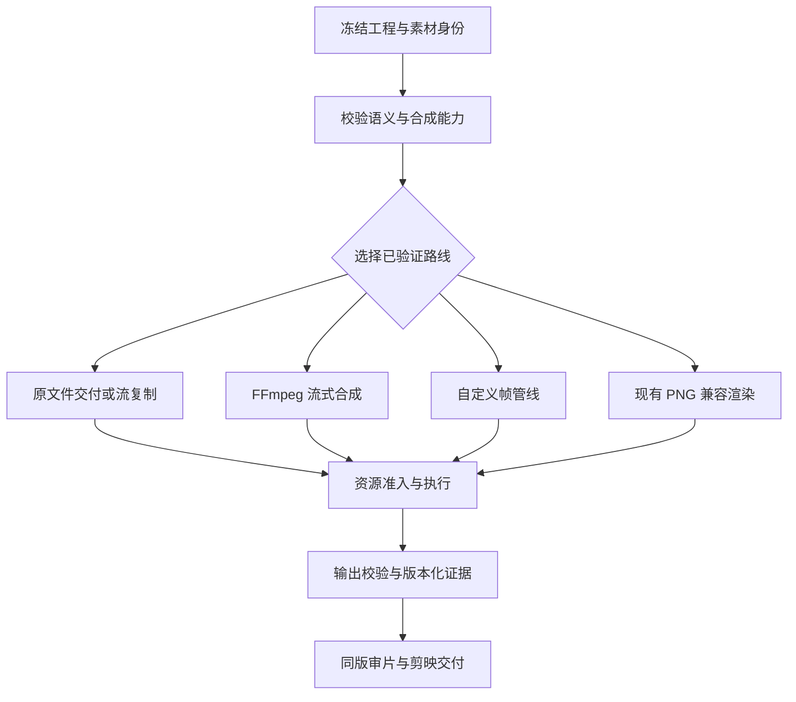

# VideoCopyer SaaS 合成方式优化方案

日期：2026-10-20。状态：设计方案，尚未实施。部署基线为[8C 32G 测试资源申请](SAAS-TEST-RESOURCE-REQUEST.md)：5 名并发用户、10 个在途制作任务、1 个本地重任务，主要处理 15～60 秒、720p／1080p、30 fps 视频。

建议在现有 D 工程、授权、执行、审片和剪映交付体系内，增加**确定性的合成路线选择**：常规剪辑采用 FFmpeg 流式合成；特殊效果保留兼容渲染器，逐步改为有界帧管线；之后再做片段缓存和局部重渲染。首期优先减少完整 PNG 序列落盘及重复处理，GPU 不作为实施前提。

## 目标与范围

本方案降低本地合成耗时、临时磁盘和重复渲染成本，同时保持已有的工程语义、全局停止、修订追溯、品牌检查、审片和可编辑剪映导出。AI 视频生成仍由外部模型服务完成，本方案不承诺缩短供应商的排队或模型推理时间。

首期交付必须让普通任务可用较轻的合成路径，并让暂不支持的效果明确走旧路径。功能不能因为“优化”被静默删掉，字幕排版、Logo 位置、透明边缘、转场和音画同步也不能默认为可接受差异。

多用户认证、Linux 凭据迁移、对象存储直传和媒体 CDN 属于部署工作，详见资源申请文档；它们可以同时推进，但不计为合成器性能收益。当前插件体验对齐已完成本地自动化验证，仍有真实模型、用户及剪映实机验收边界，见[对齐实施记录](PARITY-IMPLEMENTATION.md)。

## 调研与项目证据

| 依据 | 已确认事实 | 对本方案的影响 |
|---|---|---|
| 本项目 D 渲染器 | 输入视频先解码为 PNG，Pillow 逐帧合成，再写 PNG，最后编码 MP4 | 优先删除常规任务的全片中间 PNG，而不是先增加机器 |
| VCTestplace 房间样本 | 18.8 秒 720p，单次构建 1,297 张 PNG、约 685.8 MB；本地渲染约 54～55 秒 | 可作为固定回归素材；历史耗时不是新云实例基准 |
| Hypit 官方文档 | Composition 经 HTML／Chromium 逐帧渲染、编码并混音 | 浏览器适合丰富图文动画，但没有证据表明它普遍比 FFmpeg 或当前 D 更省资源 |
| Higgsfield 公开案例 | 有模型训练／推理基础设施，并编排自有与第三方模型 | 没有可验证的单条合成任务资源数据，不能据其规模推算我们的服务器成本 |
| FFmpeg 官方文档 | 支持跳过解码编码的 stream copy，以及直接处理帧的滤镜图 | 普通视频装配不必全部转为图片文件 |

来源：[本项目取证数据](evidence/saas-capacity-assessment.json)、[Hypit 渲染流程](https://hypit.video/quickstart/composition/)、[Higgsfield 基础设施案例](https://www.nvidia.com/en-us/case-studies/higgsfield/)、[FFmpeg 流复制与转码](https://ffmpeg.org/ffmpeg.html#Streamcopy)。

686 MB 是中间文件占用，不是进程内存；历史 2.019 GB 房间工作目录还包含修订及其他产物。现有记录没有峰值 RSS 和 CPU 采样，具体节省比例必须由同机对照测量确定。

## 路线选择与执行结构

用户继续提交同一份 D 工程。服务端根据工程特性和已验证能力选择执行路线，不增加 Agent 选编码器、写命令或计算布局的步骤。

以上“路线”是逻辑分类，不意味着要拆成四个服务。首期在同一 D 核心内实现；单机资源管理也无需先引入独立消息队列。

| 路线 | 初期接纳条件 | 不满足时的处理 |
|---|---|---|
| 原文件交付 | 唯一视频已经满足完整画面、时长、帧率、音轨和封装要求，无任何效果变更 | 转入流式合成或兼容路径 |
| Stream copy | 仅重封装、替换兼容音轨，或经过验证的同参数片段拼接；时间戳、关键帧和精确时长均符合要求 | 精确剪切边界不满足时解码处理，不能为了快而偏移切点 |
| FFmpeg 流式合成 | 支持清单内的剪切、拼接、固定缩放裁切、静态图形叠加和音频处理 | 复杂特性在编译前判定并进入兼容路径 |
| 自定义帧管线 | 必须逐帧执行的组件、品牌贴图等，且该类效果已经完成流式迁移 | 保留 PNG 渲染器 |
| PNG 兼容渲染 | 尚未通过替代实现验收的效果及明确需要的诊断流程 | 同样受资源限制，不绕过调度 |

FFmpeg 可提供 `trim`、`setpts`、`scale`、`crop`、`overlay`、`concat` 和音频滤镜；使用哪些滤镜由能力测试决定。这里是本项目的编译方案，不代表仅拼接一串滤镜名就能保持现有全部语义。[FFmpeg 滤镜文档](https://ffmpeg.org/ffmpeg-filters.html)

报价时冻结预期路线、渲染版本和允许的本地兼容回退策略。生成素材到齐后进行实际媒体探测，确认它们符合冻结假设。若需改变输出效果、执行范围或新增付费工作，应返回待处理状态；只有已声明且语义一致的本地回退可在原授权内执行。回退原因与实际路线必须写入执行记录。

## 第一阶段建立基准与资源限制

先形成可复现的测量，再改渲染器。测量拆分为输入准备、解码、合成、编码、完整解码验证、审片取帧和剪映导出，避免把某一步变快误报为整条链路变快。

8C／32G 的初始策略：

- 全站本地重任务名额为 1，完整重任务进程树的 CPU 上限初设为 4 vCPU；媒体生成等待不占这个名额。
- 解码、合成、较重预览、浏览器捕获和会触发合成的剪映导出都必须通过共同入口申请名额。不要只限制最终 MP4 渲染。
- 任务取得名额后才能启动重子进程；等待期间保持构建租约、响应停止，不能持有长数据库事务。
- 名额必须跨进程协调，带租约及所有者标识。续租失败时先终止旧进程树、核对退出，再让新任务占用名额，避免租约过期后双重执行。
- 下游调用复用已有资源租约，不能让父任务占着唯一名额又等待子任务重新申请，导致死锁。
- 独立限制大文件传输并发和缓冲，避免十个下载请求把整份文件同时读入内存。
- 页面区分“等待模型”“等待本地处理”“合成中”和“交付中”；排队不应触发 Agent 不断重试。

内存先设告警和可观测上限。普通 1080p 合成进程树以不超过 4 GB 作为测试目标；特殊效果超过该目标时须报告实际占用并调整类别，不把 4 GB 当作已测得的通用上限。

## 第二阶段增加 FFmpeg 快速路径

首个实现切片只覆盖以下内容：单段或多段视频精确剪切、顺序拼接、固定布局与缩放、静态图片／矩形叠加、原音轨或独立音轨的裁切与混合。复杂转场、品牌跟踪、程序组件、旋转及非线性动画先保留旧路径。

每段时间使用项目的有理数帧率和整数帧边界计算。统一重建片段时间戳，明确图层先后、像素比例、旋转元数据、像素格式及色彩范围；输入是可变帧率时先按已定义规则映射到项目帧时钟，不能用输入第 N 帧直接替代输出第 N 帧。

字幕分两步：

1. 普通静态文本先复用现有排版器，只在文字或样式变化时生成透明文字图，再由 FFmpeg 在对应时段叠加。相同字幕持续数秒时复用同一张图，保留字体回退与换行行为。
2. 逐字高亮、复杂描边／阴影和动画字幕，先走兼容路径；后续按视觉对照结果决定复用文字状态图、采用受控字幕滤镜，或继续使用自定义帧处理。

不直接将所有字幕改成另一套字体引擎，否则即使文字相同，也可能改变换行、宽度和位置。透明图层需明确直通／预乘 alpha 的约定并检查边缘，不能以“输出文件有效”代替视觉一致。

该阶段先保持当前经核验的 `libopenh264` 和输出配置，避免同时更换合成方式、编码器、码率导致收益归因不清。之后才单独比较编码速度、画质及文件大小。所有二进制、字体、滤镜能力必须在目标 Linux 环境探测，不假设默认 FFmpeg 包满足当前运行时检查。

流式任务中断后允许从本地合成开头重跑；已经成功的远端生成结果继续复用，不为恢复合成重新调用模型。片段级恢复留到后续阶段。

## 第三阶段迁移特殊效果到有界帧管线

保留当前 Pillow／组件绘制逻辑，替换“完整解码序列”和“完整输出序列”的文件依赖：

`顺序解码 → 有界输入缓冲 → 当前帧合成 → 有界输出缓冲 → 编码`

首期每个活跃解码输入的缓冲设为 2～4 帧，并设置所有输入共享的字节预算。1080p RGBA 单帧约 8.3 MB；十个输入各缓存四帧，单这一项约 332 MB，尚不含解码器、画布、静态图片和编码器内存。因此必须限制总体字节数，不能只限制单个队列长度。

输入按时间线惰性开启，到对应片段结束后释放。支持关键帧定位后解码到精确帧，不允许每帧启动一次 FFmpeg，也不把完整视频读入 Python 列表。遇到非顺序取帧需求时使用受限缓存或明确回退。

管线需要处理背压、短读、EOF、子进程报错和 stderr 排空。停止时解除阻塞的读写并终止整棵子进程树，临时输出不能登记成成功结果。使用当前 ProcessTree 和停止代次机制作为约束，不能只取消 Python 协程。

浏览器渲染保留给需要 HTML／CSS 表现力的片段，并纳入相同的名额与版本记录；本方案不新增全片浏览器渲染作为默认路线。是否将某个复杂效果替换为浏览器组件，由具体能力与成本对照决定。

## 审片证据与剪映兼容

当前 [engine.py](../server/app/workbench_d/commercial/engine.py) 的已完成构建预览会读取输出 PNG，并与 `result.frame_hashes` 对比；[drafts.py](../server/app/workbench_d/commercial/drafts.py) 也调用 Rasterizer 生成伴随素材。因此，只删除 PNG 写盘会破坏现有能力，必须同步改造。

建议引入版本化渲染结果契约，由统一访问层读取：

| 证据类型 | 内容与用途 |
|---|---|
| 旧版帧序列 | 保留现有 PNG、帧哈希及读取方式；历史结果继续验证 |
| 新版流式结果 | 成片哈希、规格、实际路线、渲染计划哈希、运行时身份、帧数、音频信息与验证结果 |
| 按需审片帧 | 验证绑定成片身份后，精确解码所选帧；按成片哈希、帧号及解码配置缓存，并记录图片哈希 |
| 合成前参考帧 | 必要时用于图层／排版检查，明确标注为合成参考，不冒充编码后成片截图 |
| 后续片段证据 | 每段输入身份、时间范围、输出哈希、编码参数与校验结果 |

新版不能伪造旧 `frame_hashes`，也不能将有损 MP4 解码帧声称为原 PNG 的逐像素副本。审片应优先呈现最终成片实际内容；旧版和新版证据由不同读取分支处理。

剪映继续从同一冻结的 D 工程导出原生图层和音轨，不能因为 MP4 改用 FFmpeg 就把整个工程烘焙成单条视频。不支持原生表达的部分仍沿用明确的伴随素材策略；其渲染也应接入统一资源管理。素材缺失、字体差异和实机兼容限制继续如实展示。

发布时先上线能同时读取两版结果的代码，再为新构建启用新写入格式。回退优先关闭新路线；若要回退二进制，必须保留可读取新版结果的服务能力。

## 第四阶段片段缓存与局部重渲染

第一版快速路径稳定后，再将时间线划成可独立处理的区间。优先按镜头边界切分，长镜头可评估固定长度片段；具体长度由素材和缓存收益测试决定。

缓存键应至少包含：用户／项目作用域、所用素材内容哈希、源与输出时间范围、帧率和尺寸、图层顺序及参数、字体身份、颜色与 alpha 规则、渲染器和编码器版本、输出配置。不能仅按镜头 ID 或提示词判断命中，默认不跨租户共享。

修改通过显式依赖传播决定失效范围：

- 某镜头画面或局部字幕修改，仅使其影响区间失效。
- 转场、运动模糊或具有跨帧依赖的效果，需要把依赖窗口一并重算。
- 图层跨越多个镜头时，所有交叠区间失效。
- 改变时长可能移动后续时序，不能默认只有当前镜头变化。
- 全局字体、色彩或输出规格变化可能使全片失效。

缓存片段采用一致的编码配置和可独立解码边界，只有经过探测确认兼容才拼接。音频优先单独按整片时间线混合一次，避免每个片段重复 AAC 编码造成延迟或接缝。整体限制二次有损编码次数；若片段无法直接拼接，需要将整片重编码成本和质量变化纳入验收。

片段先写临时文件，验证后原子提交清单。停止时保留已完成且有效的片段；租约丢失的旧进程不得提交结果。缓存清理依据引用关系、构建状态和保留策略，旧交付仍可播放下载。

“素材复用”“合成片段复用”和“整份交付复用”分别记录。用户只改字幕时，新增生成请求数必须为零；是否复用某个本地片段由其真实依赖决定。

## 代码改动边界

以下新模块名仅为建议，实施时可按现有结构调整。

| 位置 | 改动职责 |
|---|---|
| `commercial/render.py` | 保留公共入口、统一校验和旧渲染器；按冻结计划分派具体路线 |
| 拟新增 `commercial/render_plan.py` | 能力判定、时间线规范化、计划版本、路线与回退原因 |
| 拟新增 `commercial/render_ffmpeg.py` | 将受支持语义编译为参数数组／滤镜图；不执行 Agent 提供的任意 shell 字符串 |
| 拟新增 `commercial/frame_stream.py` | 解码与编码管线、有界缓冲、背压和进程退出 |
| 拟新增 `commercial/render_artifacts.py` | 新旧证据访问、成片校验、精确审片取帧 |
| `commercial/worker.py`、`engine.py` | 冻结路线、资源准入、租约、停止、恢复、版本化结果与预览 |
| `commercial/drafts.py` | 与同版工程一致的原生导出，伴随素材与重任务入口复用 |
| `server/local/production.py`、`commands.py` | 快照和交付契约适配；不复制另一套合成决策 |
| `server/local/workflow.py`、Web 画布 | 显示真实排队、合成、缓存命中与验证状态 |

当前运行时身份包含 commercial 源码指纹，新增实现会影响旧构建恢复。应在无活动构建时切换，或保留对应旧执行版本；禁止把旧构建的 identity 改成新值来强行恢复。新构建记录真实的新实现身份，已成功生成素材通过现有显式复用机制接入。

## 实施里程碑

| 顺序 | 可交付结果 | 进入下一步的条件 |
|---|---|---|
| M0 基准和资源准入 | 固定素材、旧渲染测量、单槽排队与进程树采样 | 停止／重启不会泄漏名额或重复运行，测量口径可复现 |
| M1 最小流式闭环 | 普通视频与静态叠图快速路径、新旧结果兼容、按需审片、同版剪映 | 语义与交付测试通过，普通样本不再落全片 PNG |
| M2 常用能力扩展 | 字幕状态图、更多布局和已验证转场 | 每个能力单独通过视觉与时间语义验收；不支持项仍明确回退 |
| M3 特殊效果管线 | 有界帧处理、组件和品牌效果逐类迁移 | 无全片内存缓存，停止可靠，视觉效果与旧实现相符 |
| M4 增量渲染 | 片段清单、缓存键、失效传播与局部恢复 | 只修改一个区间时不错误复用其他受影响内容，音频无接缝 |
| M5 云端容量定标 | 8C／32G 的单槽完整压力测试及双槽隔离试验 | 依据实测决定并发、工作盘和是否升配 |

首轮部署优化交付以 **M0＋M1** 为最小闭环；M2 按实际常用任务扩展。M3、M4 分别解决特殊效果和频繁返工成本，不要求一次重写全部能力。首期采购无需等待 GPU 方案。

## 验收方法与目标

所有性能比例均为拟定验收目标，尚未取得优化后实测结果。对照必须在同一台 8C／32G 云实例、同素材和同输出规格下运行；记录构建、缓存冷热状态及至少 5 次重复的中位数和最慢值，不把 5 个样本包装成可靠 p95。

| 维度 | 验收要求 |
|---|---|
| 基准素材 | 房间样例原工程；60 秒 1080p 普通剪辑；中文长字幕；透明 UI；多音轨；品牌贴图；复杂组件；不兼容输入与坏素材 |
| 简单路线磁盘 | 不产生全片输入／输出 PNG 序列；普通测试集中临时文件峰值目标较旧实现降低至少 80%，输入与最终交付另计 |
| 简单路线时间 | 含输出验证的本地处理时间目标降低至少 30%；未达标时报告阶段瓶颈，不以降低画质充数 |
| 内存 | 普通 1080p 合成进程树峰值目标不超过 4 GB；时长增加时缓冲不能随总帧数线性增长 |
| 时间正确性 | 输出宽高、帧率、帧数及剪切帧槽符合工程；沿用并验证现有音画时长容差，检查转场和片尾无缺帧、黑帧 |
| 视觉正确性 | 检查全部边界帧、字幕变化帧、品牌区域和代表性中间帧；固定合成规则的未编码帧可逐像素比较，不强求不同有损编码结果哈希相同 |
| 编码质量 | 固定编码参数先对照；后续调参另报告客观画质指标、人工关键区域审查和文件大小，不只报告速度 |
| 局部返工 | 字幕修改零新增生成；片段命中与失效可核对；跨边界效果不会漏算，旧交付保持可读 |
| 故障恢复 | 排队、解码、管线阻塞、编码、验证和导出阶段分别测试停止；杀 Worker 后不残留重进程，不把 partial 文件当成品 |
| 版本兼容 | 旧 PNG 证据仍可读，新路线可审片、下载、导出；运行时身份变化不触发旧请求重发 |
| 整机并发 | 5 用户、10 任务在途、1 个重任务时控制 API p95 目标低于 1 秒、停止确认低于 2 秒；用足量请求测量，排除模型推理和远端取消完成时间 |

整机持续 CPU／内存目标低于 75%，工作盘空闲超过 25%。待 1 路通过后，独立测试 2 路是否仍满足交互和资源要求；未经该测试，不提高默认并发。

先使用已存在的生成素材和本地测试夹具，性能基准无需新增模型消费。真实供应商并发测试继续遵循独立预算授权。

## 发布与后续选择

新路线按能力开关渐进启用，从固定样本开始，再扩大到普通项目。默认路线变化仅作用于新构建；执行记录能解释为什么选择或回退到某条路线。旧结果、冻结报价和历史授权不重写。

工作盘申请暂保留 500 GB。即使取消 PNG 全片落盘，原始素材、生成结果、剪映交付、历史修订和备份仍需存储；对象存储 1 TB 预算也不会按渲染提速比例自动下降。实测稳定后分别调整临时盘与长期保留策略。

GPU 作为后续可选方向：当测量显示主要成本在可加速的解码、缩放或编码，并且调用量足以覆盖 GPU 实例成本时，再评估 NVDEC／NVENC。只替换编码器不会自动加速 Python 合成或 PNG 读写，需比较整条链路单位成片成本。[NVIDIA FFmpeg 加速文档](https://docs.nvidia.com/video-technologies/video-codec-sdk/13.0/ffmpeg-with-nvidia-gpu/index.html)

本方案的完成标准是：在保留现有制作与审片能力的前提下，普通任务有经验证的低开销路径，特殊任务有明确兼容路径，资源限制跨入口一致，并能用实测数据确定 8C／32G 的运行容量。
