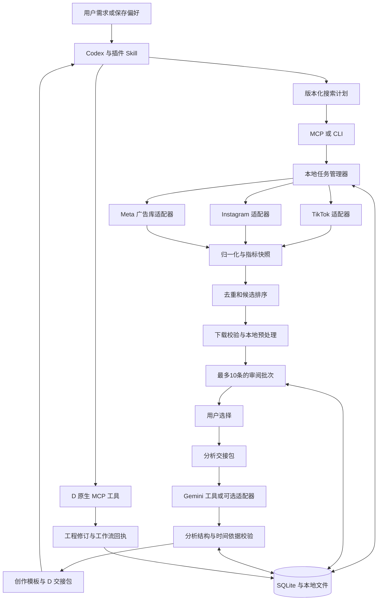

# 营销视频发现插件一期架构

日期：2026-10-19。设计名称：Marketing Scout；插件标识建议为 `marketing-scout`。本文定义待开发架构，面向本地单用户 Codex 插件。文中的 `ms_*` 工具和数据结构均为拟定契约，不代表已安装或已实现。

目标是每天按用户需求或保存的发现偏好，搜索候选视频、记录公开指标、下载最多 10 条可用视频并整理为本地审阅批次。用户选中后，由 Codex 协调 Gemini 深度分析和 D 工作台制作，形成带时间依据的报告与可复用创作模板。

模板产品体验以 [Higgsfield基线](D:/P-project/VideoCopyer_SaaS/docs/higgsfield-template-baseline.md)为准：以效果样片展示，少量产品输入即可套用，按类型提供人物/钩子/场景替换，费用可见后生成。报告服务作者，结构化契约服务后台；Gemini分析完成后还需模板制作、样片与跨产品试运行，才形成可上架模板包。上述目录与SaaS体验分阶段实现，一期先交付兼容的本地模板包。

**一期范围**

| 纳入 | 范围 |
|---|---|
| 发现渠道 | TikTok 普通视频；Instagram Reels；Meta 广告库中的 Facebook 和 Instagram 视频广告 |
| 搜索模式 | 明确需求、保存偏好、跨行业探索；关键词、标签、账号和广告主监控 |
| 本地处理 | 候选归一化、指标快照、去重、排序、视频下载、媒体校验、封面和联系表 |
| 人工筛选 | 本地审阅页与 Codex 对话共用筛选记录；保留、跳过、拒绝及原因 |
| 分析衔接 | 导出选中视频及证据清单；接收并验证 Gemini 返回的结构化观察与模板 |
| 制作衔接 | 为 Codex 输出 D 创建工程所需的制作交接包，记录实际 D 工程和工作流回执 |
| 运行方式 | MCP 与一次性 CLI 共用内核；日常执行接入 Codex 自动化，安装后另行配置 |

Facebook 普通 Reels 的全站搜索、YouTube、X、SaaS 账号与支付、公共模板发布、自动发布社交内容不在一期。Facebook 普通 Reels 可在后续增添主页监控适配器。

默认每天 10 条是三渠道合计的可审阅视频上限。原始候选数、请求数、运行时长和下载字节另设预算。当天合格视频不足时少交付并记录原因，不自动放宽日期或把旧内容补成新发现。

**关键架构决定**

1. Codex 负责理解需求、生成搜索计划、解释结果和协调后续工具；确定性程序负责请求、去重、评分、文件和状态。每日执行使用已保存的计划，不要求每天重新运行规划模型。
2. 搜索服务采用适配器接口。TikTok-Api、instagrapi 与 Meta 广告库项目分别运行，不将各自接口字段泄漏到上层业务。
3. 源数据、模型观察和营销推断分开存储。标题或搜索摘要只能作为相关性线索；未读取视频不能生成视觉钩子结论。
4. 默认采集阶段不调用付费数据商或 Gemini。用户筛选后才进入深度分析；后续允许可选批量初看，但必须有明确模型配置与预算。
5. 新插件不读写 D 或 VideoAnalyst 的内部数据库。复用其设计与经验证的公共接口，通过交接文件和工具回执关联。
6. 公共参考视频与新作品生产素材分开标记。发现时未知的许可状态保持未知，不把“公开可下载”填成“允许复用素材”。

**总体结构**



只有 Codex 负责跨插件工具协调。Marketing Scout 的 MCP 服务不能直接假设可以调用宿主中另一个插件的工具；它通过可验证的交接包传递输入，Codex 调用实际可用的 Gemini 或 D 工具，并把回执记录回来。

**开源适配层**

| 适配器 | 上游候选 | 一期调用范围 | 限制与降级 |
|---|---|---|---|
| `tiktok_web` | [TikTok-Api](https://github.com/davidteather/TikTok-Api) | 关键词搜索、标签、指定作者、视频详情；趋势入口经实测后启用 | 浏览器会话、令牌或接口失效时暂停该入口；标签或作者路径只在已测试可用时替代 |
| `instagram_private` | [instagrapi](https://github.com/subzeroid/instagrapi) | Reels/媒体搜索、标签、账号近期视频、媒体详情 | 依赖用户提供的有效会话；额外登录验证时返回待处理，不持续重登 |
| `meta_ads_browser` | [facebook-ad-library-mcp-cli](https://github.com/thenavidm/facebook-ad-library-mcp-cli) | 免费本地浏览器后端的关键词、广告主、广告详情 | 固定使用免费后端，不因环境中存在供应商密钥而自动切到收费后端；不调用付费转写 |
| `instagram_archive` | [Instaloader](https://github.com/instaloader/instaloader) | 可选的已知账号/帖子补充采集 | 不作为全站关键词搜索主入口；第二阶段再接入 |

TikTok-Api 的关键词示例与核心代码表明其使用浏览器会话和网站请求；instagrapi 的搜索实现使用客户端内部搜索接口；Meta 项目说明其免费后端读取页面初始数据及滚动后的响应。以上证明实现路线存在，实际可用性仍需在目标电脑逐项验证。[TikTok 搜索示例](https://github.com/davidteather/TikTok-Api/blob/main/examples/video_keyword_search_example.py)、[Instagram 搜索实现](https://github.com/subzeroid/instagrapi/blob/master/instagrapi/mixins/fbsearch.py)、[Meta 项目说明](https://github.com/thenavidm/facebook-ad-library-mcp-cli)

TikTok-Api 与 instagrapi 采用独立 Python 环境；Meta 适配器采用固定版本的 Node 子进程。先验证上游 CLI 的机器可读输出；若没有稳定 JSON 契约，只封装必要函数为 JSON 输入输出，不解析面向人的日志。不要在日常任务中使用 `npx @latest` 或自动更新依赖。

接入验收记录上游提交 SHA、许可证、依赖锁、浏览器版本和真实样本。前三个候选仓库声明 MIT 许可，正式打包时仍核对固定提交及依赖声明；本插件自身许可证由用户决定，不自动继承或声明。

每个适配器实现下列业务契约，未支持的方法返回明确能力错误：

```text
capabilities() -> CapabilitySnapshot
search(QuerySpec, cursor, limits) -> CandidatePage
fetch_profile_items(ProfileRef, cursor, limits) -> CandidatePage
get_detail(SourceRef) -> SourceDetail
resolve_media(SourceRef) -> MediaLocator
```

`CapabilitySnapshot` 分开记录配置存在、最近探测结果和最近成功时间。字段包括 `search_keyword`、`search_tag`、`profile_feed`、`ad_search`、`metrics_available`、`download`、`auth_required`。登录配置齐全不能直接显示“搜索可用”。探测使用有界只读请求，不触发收费服务。

`CandidatePage` 返回候选、下一页游标、实际查询条件、采集时间、字段缺失原因和源请求标识。来源没有提供可靠地区过滤时，标注结果地区未知；代理出口地区、作者所在地和广告投放地区不能混用。

**搜索计划**

保存 `DiscoveryProfile` 与不可变的 `SearchPlanRevision`。前者描述用户偏好，后者记录可直接执行的查询。

| 字段 | 意义 |
|---|---|
| `mode` | `brief`、`saved_profile` 或 `explore` |
| `markets` 与 `languages` | 目标市场和内容语言；实际返回的地域证据另存 |
| `topics` 与 `exclude_topics` | 产品、行业、痛点、场景及排除项 |
| `content_kinds` | 普通视频、广告；默认分组排名 |
| `duration_range` 与 `published_within_days` | 示例初值 15–90 秒、最近 7 天；均可配置 |
| `seed_accounts` 与 `seed_advertisers` | 已验证的作者、品牌、主页标识 |
| `queries` | 查询文本/标签/账号、适配器、入口、分页上限、生成依据 |
| `limits` | 候选上限、请求上限、下载上限、字节上限、运行截止时间 |
| `strategy_version` | 查询扩展与配额策略版本 |

有要求时，Codex 将需求拆为产品、痛点、使用场景、创作形式、品牌五类词，翻译为目标市场常用表达，生成约 8–12 个简短查询。适配器负责将通用查询转换为对应平台参数；不假设平台支持所有过滤项，无法服务端过滤的条件在本地过滤。

当天没有新要求时沿用已保存计划。完全无方向时使用跨行业探索配置；首次运行的语言和市场假设必须在结果中可见。默认主题池可包含家居、美妆、宠物、食品、健身、数码和应用软件，按日轮换，不把所有行业混成同一个传播表现榜。

候选配额建议初值为有效种子 50%、趋势/广告库入口 30%、新词和新账号探索 20%。趋势入口未验证时，该部分标为缺口或分配给已配置的轮换主题，不能伪称取得了趋势榜。

一天全局初始上限可设为 200 条原始候选、最多 60 次来源请求、30 条详情补查、最多 10 条成功下载、最多 20 次下载尝试、30 分钟运行时长和 1 GB 下载量。分页、重试与补查都消耗请求预算；预算耗尽后交付已有结果。以上是可调整的设计初值，不是性能承诺。

反馈更新保留版本：用户的保留率与明确拒绝原因改变查询/账号权重；每次只做有上限的小幅调整并保留探索配额。仅被系统展示的样本才有反馈，不能将未展示的候选当作负样本。自动新增账号先进入候选种子池，避免来源无限扩张。

**候选筛选和评分**

第一步执行硬过滤：内容类型、日期、时长、语言、明确排除项和重复项。未知字段作为未知状态展示；不伪造广告开始时间或将缺失播放量填为零。

第二步分别计算需求匹配与来源内传播信号。普通视频先按平台、语言/市场证据、主题、视频年龄段和可用指标组合形成可比组。保存原始数值、分位、样本量、组标识和公式版本。小样本组不输出看似精确的分位，回退为原始指标和“观察不足”。

普通视频在组内可使用初始推荐优先级：匹配度 45%、传播信号 30%、新鲜度 15%、来源质量 10%。匹配度来自关键词、标签、作者与用户偏好；日常默认不调用模型。传播信号综合播放与互动，但需定义统一的字段组合；缺少字段时转入对应的评分规则，不临时重分权重后混排名。

来源质量关注字段完整性、数据是否新鲜、视频是否可读取。创意多样性在最后选取阶段处理，不把尚未看过的视觉风格写成评分事实。初步使用账号、文案主题和内容哈希去重；相似画面只作为候选提示，不能仅凭同一音乐自动合并视频。

Meta 广告另用“创意参考优先级”：需求匹配、投放/发现时间证据、广告主反馈和素材完整性。广告持续投放仅作为观察信号，不表示实际 ROI；普通视频的播放分位不与广告的投放时长直接相加。每日十条通过各组候选轮转与去重产生，每条显示所属组和入选理由。

一期记录累计快照与 `observed_at`。两次观测后才能计算该区间的增长；每日一次不能精确重建首 24 小时表现。保留 `published_at`、`ad_started_at`、`first_seen_at`、`observed_at` 和可得的 `metrics_as_of`，迟发现内容不补造历史数据。首 6/24 小时监控属于后续可选高频任务。

**本地任务和媒体处理**

采用单机任务管理器、SQLite WAL 和后台 Worker，不引入 Redis、Celery 或容器编排。MCP、CLI 和审阅页共用业务服务；SQLite 保存事实状态，磁盘保存媒体与版本化导出。

MCP 提交任务后立即返回 `run_id`，隐藏窗口的 Worker 继续处理；用户通过状态工具或审阅页查看进度。适配器按来源限制并发，初始每来源一个活动任务。数据库事务保持短小，不在事务中执行网络请求或媒体处理。

```text
Run: queued → running → awaiting_review
                  ↘ partial / failed / cancelled / needs_attention

Candidate: discovered → normalized → eligible → shortlisted
                                      → downloading → ready
                                      ↘ skipped / unavailable / failed

SelectionRevision → Handoff → AnalysisRevision → TemplateRevision → D receipt
```

成功收集后进入 `awaiting_review`，不自动进入深度分析。渠道失败与整个批次状态分开记录；某来源失败且其他来源有产物时为 `partial`。空结果、被阻断和下载失败必须区分。`partial` 批次也可审阅，用户选择独立于任务状态。

任务以 `profile_id + plan_revision + 本地日期 + edition` 为运行键，重复日程触发返回已有任务。主动重跑新增 edition，重复命令保留 `command_id`。Worker 使用租约、心跳和 fencing token 防止过期进程提交结果；重启只恢复未完成步骤，不重复完成的下载和导出。

下载先写临时文件，校验字节数、哈希和 ffprobe 输出后原子提交。过期媒体地址通过原视频 ID 重新解析一次并计入预算。源文件保持原样，额外生成兼容审阅的代理视频、封面、带真实时间点的联系表；缺少 FFmpeg 时仍可完成链接发现，但不宣称已完成媒体校验。

内容指纹缓存以源标识和文件哈希为依据。重复发布的内容可以关联同一素材，但各自平台指标不得合并或累加。

**Codex 工具契约**

下面是一期拟定工具，不是当前已存在的工具。所有写操作带 `command_id`；修改已有对象时携带 `expected_revision`。返回统一包含 `schema_version`、对象 ID、状态、警告和结构化错误。大型列表分页返回，不把全部原始响应塞进 Codex 上下文。

| 工具 | 核心输入 | 输出与职责 |
|---|---|---|
| `ms_capabilities` | 可选来源过滤 | 依赖、来源能力、会话状态、最近探测记录；不显示秘密 |
| `ms_save_profile` | 偏好、搜索计划、预期修订 | 保存可重复执行的计划，返回修订与查询摘要 |
| `ms_collect` | 计划修订、当次限制、命令 ID | 创建发现/详情/下载流水线，立即返回 run_id |
| `ms_run` | run_id，action=`status/cancel/resume` | 状态分页；取消和恢复使用命令 ID，needs_attention 不自动恢复 |
| `ms_candidates` | run_id、过滤条件、游标 | 候选指标、来源、入选理由与本地预览引用 |
| `ms_review` | 批次、预期选择修订、逐条决定及原因 | 保存选择修订；返回选择范围，不触发模型或制作 |
| `ms_prepare_handoff` | 精确选择修订、分析目标 | 导出校验过的选中视频、证据、分析契约与来源清单 |
| `ms_record_result` | handoff_id、结果文件 ID、模型/输入绑定 | 校验并导入分析与模板修订；不能只凭一句“分析完成”更新成功状态 |
| `ms_prepare_d` | 模板修订、用户品牌资料引用 | 返回制作交接包、变量缺口、素材要求与支持范围；不直接操作 D |
| `ms_bind_d` | handoff_id、D 项目/修订、实际工具回执 | 记录与本次模板对应的 D 工程、检查和归档状态 |

审阅页的地址和本地资源引用随批次返回。Codex 使用实际打开工具展示页面；后台服务运行不代表用户已经看见页面。

**审阅界面**

提供一个只监听 loopback 的轻量页面，放在 Codex 右侧浏览器面板。可以用 FastAPI 加少量 TypeScript 实现，不迁入现有 SaaS 全部前端和数据库。

卡片显示视频、原始页面链接、平台/广告标识、发布时间与指标采样时间、播放互动、推荐依据和已知缺口。用户可播放、保留、跳过或拒绝，并选择“无关、重复、难复刻、画面好、钩子值得分析”等原因。未完成视频分析时，“钩子好”只能是用户评价。

页面和 MCP 通过同一 Review 服务保存选择，使用乐观锁防止旧页面覆盖新决定。页面只渲染转义后的外部文案，写请求验证本地会话与来源；不通过 URL 直接提供任意磁盘路径。详情中的 Cookie、令牌、媒体签名查询参数不进入日志或模型上下文。

**核心数据结构**

| 对象 | 必需字段与约束 |
|---|---|
| `DiscoveryProfile` | id、revision、偏好、种子、排除项、limits |
| `SearchPlanRevision` | profile_id、revision、queries、strategy_version、创建依据；不可变 |
| `Run` / `StepAttempt` | 计划修订、运行键、命令 ID、状态、预算、游标、租约、心跳、错误 |
| `SourceItem` | platform、kind、native_id、canonical_url、作者/广告主、各类时间、地区证据；唯一源身份 |
| `DiscoveryHit` | run_id、query_id、source_item_id、来源排序、采集时间；保留多个查询命中关系 |
| `MetricSnapshot` | source_item_id、observed_at、metrics_as_of、指标值、指标定义、单位、缺失原因 |
| `RankDecision` | run_id、source_item_id、规则版本、可比组、组成项、置信提示、入选原因 |
| `MediaAsset` | 源引用、sha256、相对路径、时长、编码、时间基、采集工具版本、来源与许可状态 |
| `ReviewDecision` / `SelectionRevision` | 批次、候选、决定、原因、用户操作时间、选择修订 |
| `Handoff` / `AnalysisRevision` | 精确选择与素材哈希、输入覆盖、模型与提示版本、usage、观察、推断、时间引用 |
| `TemplateRevision` | 分镜、参数变量、证据引用、素材要求、制作限制、分析修订 |
| `DReceipt` | 模板修订、D 项目 ID、工程修订、检查/构建/归档回执与时间 |

原始来源响应只保留必要且去敏的调试副本。未知指标用 null 加原因表示；计数、曝光、播放和触达保留不同字段，不能统一叫 views。源码缓存和用户数据分离，插件升级不覆盖用户库。

**Gemini 分析与报告**

当前会话未发现可调用的 Gemini 工具，因此一期以交接契约为基础，不能把“Gemini 原生工具已接通”作为前提。用户环境有可用工具时由 Codex 调用；若没有，则另接一个明确配置的 Gemini 文件分析适配器，复用相同输入输出，不用普通文本模型冒充视频观察。

选中后的两遍流程参考 VideoAnalyst：第一遍读取视频，输出带时间位置的画面、口播、字幕、节奏等观察；第二遍基于这些观察重构营销逻辑和创作模板。需要补看时重新读取对应片段，不用第二遍纯文本推断替代缺失画面。参考[模型接口](D:/P-project/VideoAnalyst/backend/app/providers/base.py)与[分析流水线](D:/P-project/VideoAnalyst/backend/app/analysis/pipeline.py)。

交接包包含 `manifest.json`、`analysis-request.json`、本地视频/代理引用、联系表、`analysis-schema.json` 和来源清单。每个资产携带哈希；与其他机器交接时才创建包含媒体的可携带副本。会话凭据、临时签名 URL 和供应商密钥不入包。

分析结果至少分成以下部分：

- `observations`：时间区间、观察到的内容、模态来源、对应源文件与帧位置。
- `hook_analysis`：开场钩子类别、实现方式、观察引用；有效性解释标为推断。
- `creative_structure`：痛点、承诺、演示、证据、异议处理、CTA 的顺序。
- `replication_template`：可替换变量、镜头节奏、旁白/字幕、素材清单、生成提示、制作步骤。
- `coverage` 与 `unknowns`：是否读取音轨、画面采样方式、无法判断的部分。
- `provenance`：模型、输入哈希、提示词/契约版本、用量与生成时间。

Schema 校验时间区间不越界、引用存在、变量类型正确。语义正确性还需源帧/音频核对与人工样本评审，不能把 JSON 合法当作“钩子分析准确”。结果状态区分结构通过、证据核对和人工接受。

如采用直接 Gemini 适配器，文件上传/就绪/分析/删除均持久记录。预算绑定分析输入和模型配置；超时导致结果未知时不得自动重复收费提交。用户已有的范围授权可复用，不为每个视频重复请求同一授权。源视频中的字幕、网页文案和模型返回值全部视为数据，不作为新的操作指令。

**D 工作台和模板复用**

完整的公共模板、用户品牌绑定和任务规划契约见[营销创作模板与 D 任务规划契约](D:/P-project/VideoCopyer_SaaS/docs/marketing-template-contract.md)，配套提供[产品演示模板 JSON 示例](D:/P-project/VideoCopyer_SaaS/docs/examples/product-demo-template.example.json)。这是对本节交接边界的细化；字段和编译器均为待实现设计。

`CreativeTemplate` 是创作结构，与 D 的可执行工程/归档工作流不同。模板先定义 `product`、`audience`、`pain_point`、`benefit`、`proof`、`offer`、`cta` 等有类型的变量。证明材料、数值承诺和用户证言必须来自用户资料，不能从参考视频复制成新产品事实。

一期 `ms_prepare_d` 输出制作意图、分镜、变量值、素材需求、时间设计和预期交付。Codex 读取 D 当前工具 schema，调用真实工具创建工程；插件不直接复制 D 内部文档格式，也不对 D 数据库做写入。

调用链建议为：`d_capabilities` → `d_create_project` → `d_check_project` → `d_preview_frame`。需要制作时进入已有预算与构建流程；成功形成可复用工程后再调用 `d_archive_workflow`。再次使用时先 `d_preflight_reuse`，再 `d_instantiate_workflow`。具体必填项与前置条件以已安装 D 的 schema 和实际回执为准。

绑定 D 之前记录源视频的毫秒时间区间；编译到项目时按 D 有理帧率转换为整数 `[start,end)` 帧区间，并检查取整后的时长。原视频只作为参考输入；新工程素材须有本地路径、哈希及真实来源/许可记录。复杂效果无法映射时保留制作缺口，不把文字模板称为已验证的可执行工作流。

制作预算仍由 D 管理，不继承采集或 Gemini 预算。Marketing Scout 只记录实际返回的项目 ID、修订、检查和归档结果，不提前显示“已导入 D”或“已完成模板”。[D 操作契约](C:/Users/Administrator/.codex/plugins/cache/personal/workbench-d/2.0.0-beta.1/skills/workbench-d/SKILL.md)

**目录与技术选择**

以下为待创建目录设计，本次架构交付不创建空实现或注册插件。

```text
marketing-scout/
  .codex-plugin/plugin.json
  .mcp.json
  skills/marketing-scout/SKILL.md
  skills/marketing-scout/references/
  scripts/setup.ps1
  scripts/run.ps1
  src/marketing_scout/
    mcp_server.py
    cli.py
    profiles/
    discovery/
    adapters/
    ranking/
    media/
    review/
    handoff/
    jobs/
    store/
  bridges/meta_ads/
  web/
  schemas/
  tests/fixtures/
  requirements.lock.txt
  THIRD_PARTY_NOTICES.md
```

控制内核采用 Python 3.12、Pydantic、SQLite；MCP 使用官方 Python SDK 的固定版本。审阅页使用 FastAPI 和轻量 TypeScript；下载与探测使用有界 HTTP 客户端和现有经过验证的 FFmpeg/FFprobe 路径。Python 和 Node 依赖隔离；不借用正在运行的 D 虚拟环境安装新包。

Windows 外部数据根建议为 `%LOCALAPPDATA%/MarketingScout`，可通过 `MARKETING_SCOUT_HOME` 指定。其下分 `runtime`、`data/control.sqlite3`、`data/media`、`data/batches`、`data/handoffs`、`data/templates` 和 `logs`。安装路径与数据路径分离，副本和媒体清理依据引用关系执行；默认先报告可清理内容，用户明确启用保留策略后才自动清理。

插件 manifest 仅声明真实存在的 Skill 和 `.mcp.json`，开发时使用 plugin-creator 的生成与验证工具。安装、市场注册和日程配置在实现验收后执行，本架构不创建这些状态。

**每日调度与故障边界**

一期由 Codex 自动化在选定本地主机触发 `ms_collect`；同一计划每天只创建一份默认批次。MCP 只负责提交与查询，Worker 完成采集。主机离线时不承诺按时运行；恢复后通过运行键判断当天是否已执行，最多补当前批次，不连续补抓每一个错过日期。

插件不自行递归创建 Codex 任务或日程。通知只在批次就绪、明显失败或需要用户处理会话时出现。CLI 保留同样的单次执行入口，便于后续独立部署；一期不另外建设调度平台。

| 错误 | 行为 |
|---|---|
| `AUTH_REQUIRED` / `CHALLENGE_REQUIRED` | 暂停相关来源，显示需用户处理的会话状态；不自动破解验证 |
| `RATE_LIMITED` | 遵循上游等待信息，少量有界重试，超出本次时间预算后交付部分结果 |
| `SOURCE_CHANGED` | 保存去敏诊断，停用受影响入口；其他入口继续 |
| `NO_RESULTS` | 标记该查询无结果，不等同于服务故障或全平台无相关视频 |
| `MEDIA_EXPIRED` | 通过源 ID 有界重新解析媒体链接 |
| `INVALID_MEDIA` / `DISK_LIMIT` | 不标记下载成功；跳过或暂停，保护已完成文件 |
| `BUDGET_EXHAUSTED` | 停止新增请求，保留当前结果与未完成阶段 |
| `PROVIDER_RESULT_UNKNOWN` | 保留模型请求身份和用量状态，先核对结果再决定恢复 |

会话凭据存系统凭据管理器或受限会话文件，工具只返回引用和状态。下载仅允许 HTTP(S) 来源，检查重定向与本地/私网地址，限制文件大小和超时；工具接收注册资产 ID 而非任意文件路径。来源文本不能驱动 shell、读取凭据或修改插件。依赖更新后先跑固定样本，失败保留旧版本。

**开发顺序与验收**

| 阶段 | 工作 | 完成信号 |
|---|---|---|
| A 来源探针 | 固定开源版本；各来源 3 组查询、2 个账号/广告主、10 条详情或媒体样本 | 分别报告搜索、详情、下载成功率与缺失字段；失败也计入分母 |
| B 插件内核 | MCP/CLI、计划版本、SQLite、任务恢复、归一化、来源适配 | 同一命令重试不重复创建；一个来源失败不阻塞其他来源 |
| C 日常批次 | 规则评分、去重、下载校验、审阅页、用户反馈 | 每条入选理由可追溯；最多 10 条真实可播放视频；不足明确显示 |
| D 分析和制作交接 | 选中素材包、结构化结果校验、D 交接与回执 | 实际完成至少一条选中视频的 Gemini 分析，以及一个 D 工程的创建与校验 |
| E 连续验证 | 7 天日常运行、断网/进程退出/会话失效/过期链接场景 | 无重复批次，无未授权收费，能定位失败并恢复；反馈能影响下版计划 |

评分测试关注缺失值、同源去重、时间窗口和不同指标口径；任务测试关注幂等与崩溃恢复；模型质量使用真实视频人工核对。录制响应测试验证解析，不能替代真实平台探针。

在三个开源入口通过验证、Gemini 已有可用调用路径的前提下，单名熟悉项目的工程师预计 10–16 个工作日完成本地一期开发，连续运行观察可与后半段开发部分重叠。若要新增 Gemini 文件适配器，另估 2–4 个工作日；来源接口修复和登录环境问题按探针结果重新估算，不把上游变化压入固定承诺。

首个开发里程碑应当是来源探针与一份真实的本地候选批次。之后再接反馈、分析和 D 交接，避免界面完成后才发现搜索入口不能用。
